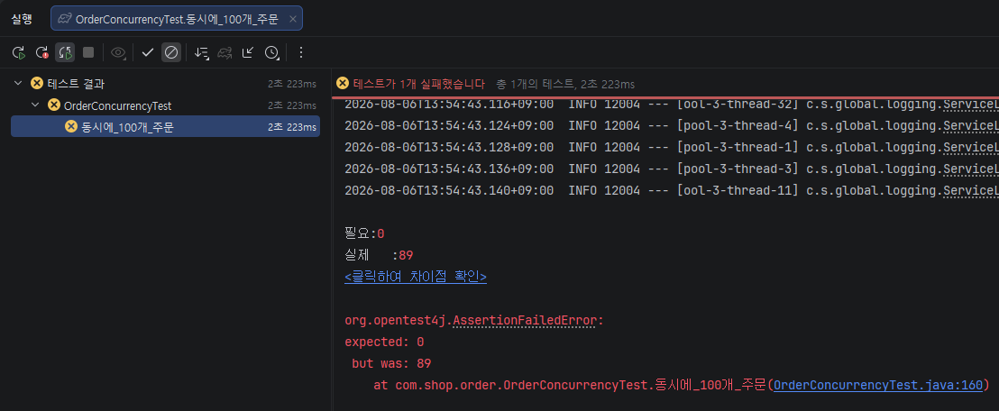
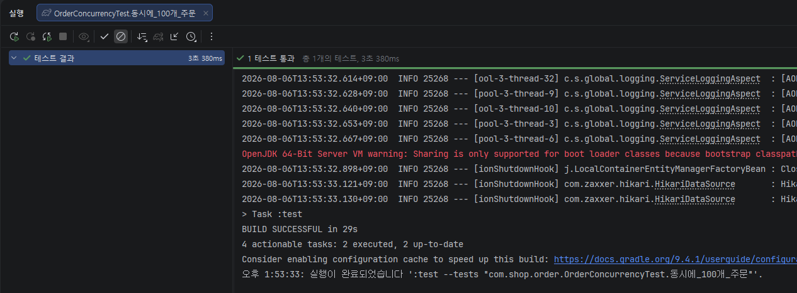
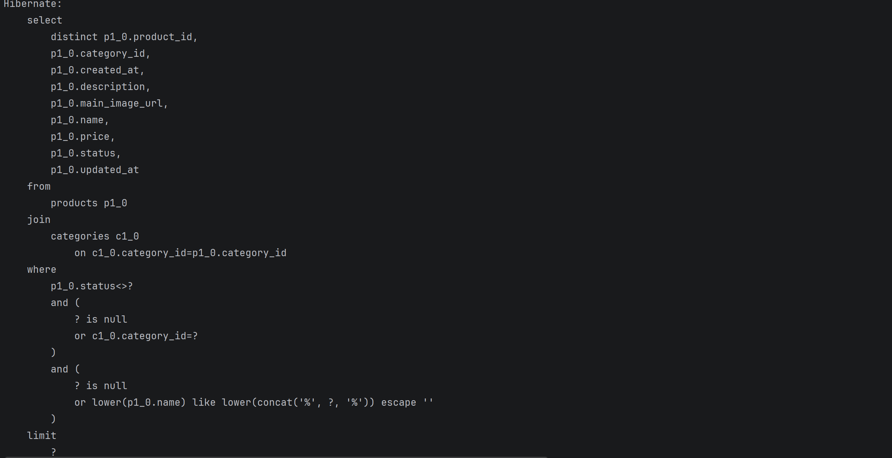
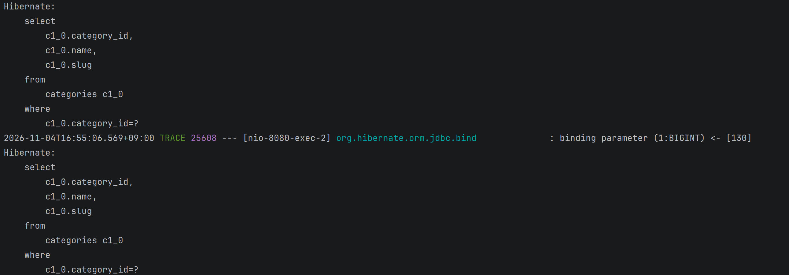
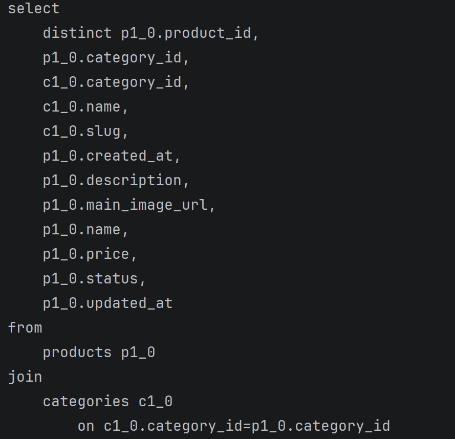
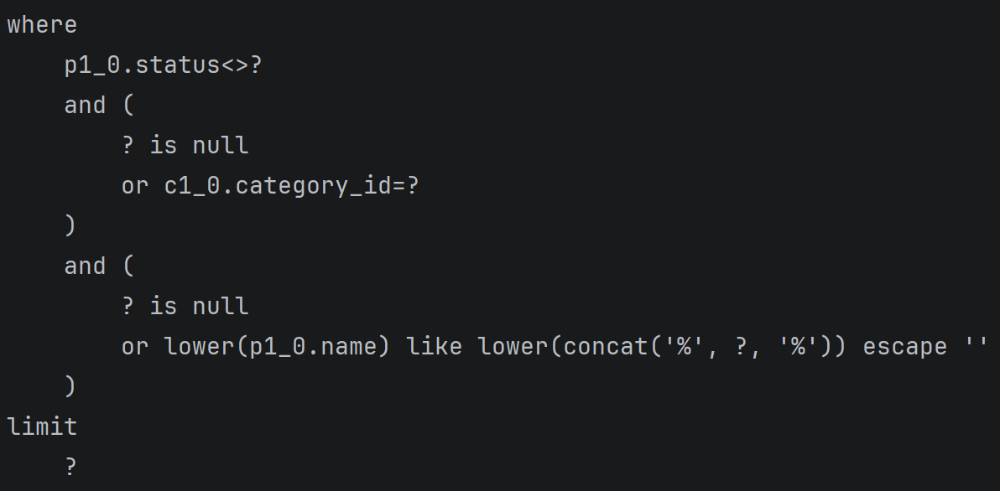

# E-commerce Backend Project

<br/>

## 📖 프로젝트 소개

Spring Boot 기반 이커머스 백엔드 프로젝트  

<br/>

## ✨ 주요 기능

*   **회원 관리:** 회원가입, 로그인 
*   **상품 관리:** 상품 등록, 조회, 수정, 삭제 / 카테고리 등록, 조회, 수정, 삭제
*   **주문 관리:** 상품 주문, 주문 조회, 주문 취소 기능
*   **장바구니:** 사용자가 원하는 상품을 담고 관리
*   **Q&A:** 상품 및 주문에 대한 고객 문의를 처리하는 Q&A
*   **관리자:** 관리자 전용 페이지를 통해 매출 조회, 회원, 상품, 주문, 재고 관리 등 시스템의 전반적인 데이터 관리  

<br/>

## 🛠️ 기술 스택

*   **Language:** Java 17
*   **Framework:** Spring Boot 4.0.5
*   **Database:** MySQL 8.0.41, JPA 4.0.5
*   **Security:** Spring Security, OAuth2, JWT  

<br/>

## 📅 개발 기간
* 2026.03 ~  

<br/>

## 📝 API 문서

*   **Swagger UI:** `https://jhm0919.github.io/swagger-ui/`  

<br/>

## 🎯 트러블슈팅

### 1. 동시 주문에서 재고 정합성 문제

#### 문제

재고 100개 상품에 대해 동시에 100건 주문 시, 11건의 주문만 처리되고 89개의 재고가 남는 동시성 문제 발생



#### 원인

여러 트랜잭션이 같은 재고 값을 읽은 뒤 각각 차감할 수 있었다. `@Transactional`은 각 요청의 작업을 트랜잭션으로 묶지만, 동일 상품을 수정하는 요청 간 경쟁을 막아주지는 못한다.

#### 해결

주문 생성에 사용하는 상품 조회에 `PESSIMISTIC_WRITE` 락 적용, 같은 상품을 주문하는 트랜잭션은 먼저 처리 중인 트랜잭션이 끝날 때까지 대기한 뒤 재고를 차감한다.

```java
@Lock(LockModeType.PESSIMISTIC_WRITE)
@Query("""
        SELECT p
        FROM Product p
        JOIN FETCH p.skus
        WHERE p.id = :productId
        """)
Optional<Product> findByIdWithPessimistic(@Param("productId") Long productId);
```

주문 서비스는 이 락 조회로 가져온 상품의 SKU 재고를 차감한다.

```java
Product product = productRepository.findByIdWithPessimistic(req.productId())
        .orElseThrow(() -> new ProductNotFoundException(req.productId()));

Sku sku = product.findSkuById(req.skuId());
product.decreaseSkuStock(req.skuId(), req.quantity());
items.add(OrderItem.of(product, sku, req.quantity()));
```

#### 검증

`OrderConcurrencyTest.동시에_100개_주문`에서 재고 100개인 SKU에 주문 100건을 동시에 요청 했을 때 변경 후 테스트에서 주문과 최종 재고가 기대한 값과 일치하는 것을 확인



### 2. 상품 목록 조회의 N+1 쿼리

#### 문제

상품 목록 응답에는 카테고리명이 포함됨. 기존 쿼리는 카테고리를 `JOIN`해 필터링에 사용했지만, `Category` 엔티티까지 함께 로딩하지는 않는다. 응답 변환 중 `product.getCategory().getName()`에 접근하면서 카테고리가 지연 로딩되어 추가 쿼리 발생했다.

재현 데이터 : 상품 4개, 서로 다른 카테고리 2개
변경 전에는 상품 목록 조회 1회와 카테고리 조회 2회로 총 3회의 쿼리가 실행 
추가 조회 횟수는 목록에 포함된 서로 다른 카테고리 수에 따라 더 늘어날 수 있다. 지금처럼 데이터가 적으면 큰 문제가 없지만 데이터가 많아지면 성능에 영향을 줄 수 있다.




#### 해결

상품 목록 쿼리의 `JOIN`을 `JOIN FETCH`로 변경해 상품과 카테고리를 함께 로딩하여 해결.

```java
@Query("""
        SELECT DISTINCT p
        FROM Product p
        JOIN FETCH p.category c
        WHERE p.status <> :excludedStatus
          AND (:categoryId IS NULL OR c.id = :categoryId)
          AND (:keyword IS NULL OR
               LOWER(p.name) LIKE LOWER(CONCAT('%', :keyword, '%')))
        """)
Page<Product> findProductList(
        @Param("categoryId") Long categoryId,
        @Param("keyword") String keyword,
        @Param("excludedStatus") ProductStatus excludedStatus,
        Pageable pageable
);
```

`JOIN FETCH`를 사용하면 DTO 변환 시 카테고리명에 접근해도 별도 카테고리 조회가 발생하지 않음

#### 검증

같은 데이터와 요청으로 변경 전후 SQL을 비교했을 때, 변경 후 상품 목록과 카테고리명을 정상적으로 반환했고, 전체 조회 쿼리는 3회에서 1회로 줄어듦.



